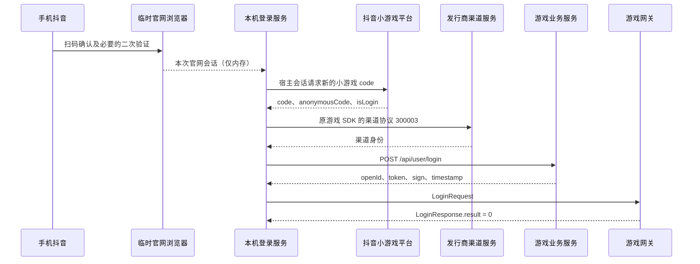

# 抖音扫码登录与认证链

分析与验证日期：2026-11-18（北京时间）。目标为《疯狂水世界》抖音小游戏，公开 AppID 为 `tt76340089e939a1bf02`，PC 抖音宿主 aid 为 `6383`。本文仅保留公开接口、字段名、脱敏结果和复现方法。

## 控制台使用

在 **账号 → 添加账号 → 抖音扫码** 点击 **生成二维码**，使用游戏角色所属的手机抖音账号扫码并确认。若提示二次验证，在手机抖音中完成身份验证；页面会继续等待，并显示更新后的二维码。不要向控制台输入抖音密码、短信验证码或人脸资料。

登录成功后，选择已有区服和游戏角色，再点击 **保存所选角色**。只有一个角色时自动选中；角色查询失败可重新读取。二维码过期后刷新，取消、返回或关闭弹窗会结束本次临时会话；请求正在处理时，等待完成后再操作。

新账号保存后默认不挂机；已有账号沿用已保存的自动挂机选择。重新扫码会更新同一抖音账号的登录配置，旧版电脑采集的抖音账号也按同一渠道识别，保留原有配置和人工备注。读取角色及登录游戏可能使同账号的其他游戏客户端下线。待保存结果在内存中保留 10 分钟，到期后需要重新扫码。

官网登录使用隔离的临时浏览器，Windows 上会打开可见的官方登录窗口。若官网要求页面验证，请在该窗口自行完成；控制台不会代答验证码或进行人脸验证。取得游戏凭证、取消或超时后关闭临时浏览器；抖音主账号 Cookie 不写入账号配置，也不返回网页。账号文件仅保存运行游戏需要的登录配置。正常扫码流程不安装 CA、不修改系统代理。

旧的电脑采集仍保留在 **添加账号 → 备用登录方式 → 电脑抖音采集**，也用于处理旧采集的异常恢复。

## 资源与运行条件

- 需要可用的 Edge、Chrome 或自动准备的 Chromium；可用 `CW_BROWSER_EXECUTABLE` 指定浏览器。
- Windows 控制台应运行在可交互的桌面会话中，以便完成官网可能要求的页面验证。无头浏览器可能停留在验证中间页，不应通过修改站点检测或代答验证码绕过。
- 需要本机抖音版游戏静态资源。先在电脑抖音中打开一次游戏，默认从 `%APPDATA%/douyin/microGameCache/resource/packages/tt76340089e939a1bf02/` 选择可用版本。
- 可设置 `CW_DOUYIN_GAME_DIR` 为该小游戏的版本目录，或其包含版本子目录的包目录。版本目录需包含 `subpackages/minisdk/ttMiniSuperSDK.js`、`subpackages/main/game.js` 和 `src/settings*.json`。
- 读取的是静态 SDK、游戏代码和配置；不会将客户端已使用的缓存 code 当作新凭证复用。还需能访问官方登录服务、游戏平台、发行商认证服务和游戏 CDN。
- 游戏协议包的准备沿用项目现有要求；抖音静态 SDK 与游戏协议资源不随仓库分发。

## 已验证的认证链



本次已独立验证完整链路成功：平台换码返回 HTTP 200、`err_no=0`、`isLogin=true`；发行商业务认证返回成功且游戏凭证四项完整；使用抖音版协议、`worldId=0` 进行一次网关验证，返回 `LoginResponse.result === 0`，随后断开。验证没有选择新的区服、创建角色、运行挂机或执行充值。

这一链路无需调用电脑抖音的运行时桥来取 code；电脑客户端提供本机静态资源作为实现依据。官网扫码取得的宿主会话、小游戏临时 code 和最终游戏 token 是不同层级的凭证，不能互相替代。

### 平台取 code 的实际请求

```text
GET https://minigame.zijieapi.com/mgplatform/api/apps/v3/login

Query:
  appid       = tt76340089e939a1bf02
  aid         = 6383
  anonymousid = 空字符串

Headers:
  X-Tma-Host-Sessionid = 本次官网会话的 sessionid（仅内存传入）
  X-Tma-Host-Deviceid  = 空字符串
```

接口来源是官方公开 PC SDK `miniapp-pcsdk-node/1.0.0.177/game/index.js` 的登录模块 73676。本次空 `anonymousid` 与空宿主 Deviceid 实测被接受，不代表所有账号和未来版本都不会增加检查。代码中的宿主字段是 `did`，不能擅自用另一个 `deviceId` 字段替代。

原游戏 SDK 随后完成初始化、请求封包与签名：渠道默认地址为 `https://minigame.ewan.cn/minigame`，登录协议为 `300003`；业务默认地址为 `https://api.gzxianc.com/api/user/login`。SDK 支持备用域名。最终字段映射为 `openId=m.openId`、`token=m.signToken || m.token`、`sign=m.sign`、`timestamp=m.ts.toString()`，时间戳保持原始单位。正式网关是 `wss://dhyaoj-gate.khlgamen.com/ws`，角色和当前热更新版本还须以真实响应及发布清单为准。

### code 是否固定

同一账号完整退出并重开小游戏两次，`code`、`anonymousCode` 和小游戏 `session` 每轮都改变，身份字段保持一致。观察只保存本次随机密钥生成的 HMAC 指纹，不保存原值或密钥。这排除了本目标的 code 长期固定的假设；不能仅凭长度相同判断值相同，也不能据此推导旧 code 仍可兑换。客户端缓存中的 code 可能已被游戏消费，独立登录应请求新的 code。

### 能否完全不用浏览器

二维码由官方 Passport 服务生成；网页调用 `GET /passport/web/get_qrcode/` 取得本次扫码会话，并通过 `POST /passport/web/check_qrconnect/` 轮询。网页还负责会话初始化、CSRF、设备环境和登录回调，以及官方要求的二次验证。因此浏览器不是游戏认证协议的必要组成部分，但省略浏览器需要完整复现官方网页登录流程，不能只复制 UA 或固定业务参数。

本次对官方取码接口进行一次不带 Cookie 的最小匿名请求，HTTP 返回 200，但业务返回 `error_code=4031` 和验证相关字段，没有二维码或扫码 token。未重试绕过验证。这个结果不足以单独判定缺少哪项环境信息，也不能证明纯 HTTP 永远不可行；目前没有完成纯 HTTP 的扫码确认、二次验证及 Cookie 落地验证。

当前实现因此保留隔离的官方浏览器来取得会话，之后的小游戏 code 获取与游戏凭证兑换均使用独立 HTTP 请求。官网二维码读取兼容 `alt`、`aria-label` 与已观察的二维码容器，并排除被验证浮层遮挡的旧二维码；二维码中央的官方图标不会被误判为整张图片不可见。

### 为什么系统代理没有抓到换码

已检查的官方 PC SDK 使用 **Node Axios HTTP adapter** 发送 `v3/login`，由 `hostConfig.httpProxy` 控制该层代理，默认配置为空。它不自动沿用 Windows 的浏览器系统代理；环境变量或宿主额外配置仍可能影响实际路由。因此 CONNECT 域名记录和单域名 TLS 观察只能说明经过该代理的流量，没看到登录请求不能证明请求不存在。

本次单域名观察看到了小游戏入口 HTML 与 `v3/meta`，实际 `v3/login` 来自公开 SDK 静态定位并通过独立请求验证。目录、元数据接口与换码接口不能混为一谈。

## 保留的诊断工具

源码保留在 `tools/douyin-analysis/`，不属于正常扫码登录所需步骤。输出、恢复记录和临时证书全部写入 Git 忽略的 `work/douyin-analysis/network/`；不应提交该目录的数据或证书材料。

### 只记录域名

```powershell
# 默认只读预检，不监听、不改代理
node tools/douyin-analysis/domain-discovery.mjs --dry

# 明确开始限时观察；不安装 CA，不解密 HTTPS
node tools/douyin-analysis/domain-discovery.mjs --run --seconds 180

# 异常退出后的独立恢复
node tools/douyin-analysis/domain-discovery.mjs --run --recover
```

默认 120 秒，最多 180 秒。输出仅为允许域名的 CONNECT 主机、端口和时间，其他流量仅计数。可用 `--domains example.com,example.cn` 替换域名范围，用 `--stop-file` 指定提前结束文件，或按 `Ctrl+C`。输出位于 `work/douyin-analysis/network/discovery-state/`。域名记录无法确定发起进程或请求路径。

### 单域名 HTTPS 观察

```powershell
# 只读预检，不创建证书、不监听、不修改代理
node tools/douyin-analysis/https-observe.mjs --dry

# 先确认临时 CA 变更，再执行；Windows 信任提示由用户本人处理
node tools/douyin-analysis/https-observe.mjs --run --confirm-ca minigame.zijieapi.com --seconds 180

# 仅恢复本次代理并移除本次精确指纹的新 CA
node tools/douyin-analysis/https-observe.mjs --run --recover
```

只解密 `minigame.zijieapi.com:443`，其他 CONNECT 直接转发，上游证书验证保持开启。输出 HTTP 方法、路径、查询键、请求头名称、状态和 JSON 字段路径；字符串只保留长度与当次 HMAC，少量登录布尔值或错误编号可直接记录。不保存原始 Cookie、Authorization、查询值、响应头值或正文。gzip、br、deflate 采样的压缩体和解压体均有 1 MiB 上限，无法采样时仍继续转发。

输出与恢复状态位于 `work/douyin-analysis/network/https-state/`。提前结束可按 `Ctrl+C`，或创建该目录下的 `stop` 文件。结束时先恢复代理，再删除本次新 CA 和证书材料；失败则保留恢复记录以便重试。

两种工具均复用当前用户的采集锁，拒绝活动上游代理、PAC、自动代理发现或其他待恢复会话，保留原 ProxyEnable、残留 ProxyServer 和完整 ProxyOverride。独立 watchdog 按运行 ID、父进程和截止时间恢复；断电或所有相关进程被一并终止后，仍需手动执行恢复命令。

### 离线验证

```powershell
node tools/douyin-analysis/selfcheck-domain-discovery.mjs
node tools/douyin-analysis/selfcheck-https-observe.mjs
node tools/douyin-analysis/selfcheck-https-observer.mjs
```

这些检查使用内存代理、注册表及证书替身，覆盖路由保护、截止竞态、失败恢复、精确域名限制、HMAC 脱敏和压缩上限，不监听真实网络或修改系统设置。

## 官方背景资料

- [PC 抖音小游戏接入指南](https://partner.open-douyin.com/docs/resource/zh-CN/mini-game/develop/guide/open-ability/pc-game/game-tutorial)：PC 宿主名称为 `douyin_web`。
- [小游戏场景值](https://developer.open-douyin.com/docs/resource/zh-CN/mini-game/develop/framework/scene-value/)：PC 抖音宿主 APPID 为 `6383`。
- [小游戏 code2Session](https://developer.open-douyin.com/docs/resource/zh-CN/mini-game/develop/server/log-in/code-2-session)：临时 code 与游戏开发者服务端认证的职责。该服务端接口不是本工具替代发行商业务认证的入口。
