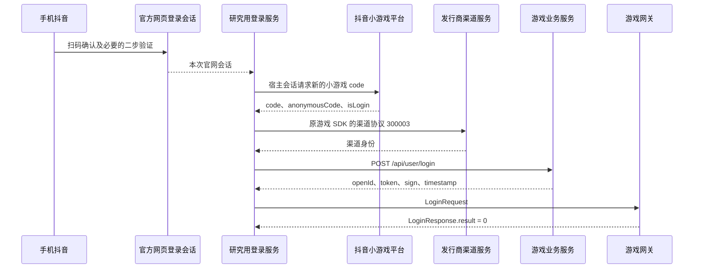

# 抖音登录研究归档与抓包方案

归档日期：2026-11-19（北京时间）。历史分析与验证于 2026-11-18 至 2026-11-19 完成。本文只保留公开接口、字段名、脱敏结论和诊断方法，不包含真实账号、Cookie、code、token、二维码、设备标识或证书私钥。

## 当前状态与结论

**抖音扫码登录、无窗口扫码及控制台内手动验证功能已从项目移除。当前抖音登录仅保留电脑客户端采集方式。本文是研究归档，不是现行扫码功能的使用教程。**

**扫码后可能还会出现二步验证，流程过于复杂、操作麻烦，不建议接入。** 即使某次能够取得二维码，也不能保证后续扫码确认、网页交互验证、手机身份验证和 Cookie 落地都能稳定完成。研究中曾验证完整认证链可行，但用户操作和维护成本过高，因此停止产品接入。

当前使用方式见[电脑抖音采集](console-guide.md#电脑抖音采集)：登录本机电脑抖音，开始采集后重新打开《疯狂水世界》，由工具读取最终游戏登录报文并恢复本次代理和证书改动。独立样本 CLI 不会自动导入账号；既有账号备份仍按普通账号导入、导出规则处理。

## 历史验证：认证链

研究目标为《疯狂水世界》抖音小游戏，公开 AppID 为 `tt76340089e939a1bf02`，PC 抖音宿主 aid 为 `6383`。



历史实测曾独立跑通完整链路：平台换码返回 HTTP 200、`err_no=0`、`isLogin=true`；返回的小游戏身份与同账号 PC 客户端缓存一致；发行商业务认证返回成功且游戏凭证四项完整；使用抖音版协议、`worldId=0` 进行一次网关验证，返回 `LoginResponse.result === 0`，随后断开。验证没有选择新的区服、创建角色、运行挂机或执行充值。

这证明当时的协议链能够复用网页登录态，不代表已移除的扫码功能仍受支持，也不能推导所有账号和未来版本均能跳过额外验证。官网宿主会话、小游戏临时 code 与最终游戏 token 是不同层级的凭证，不能互相替代。

### 平台取 code 请求

以下只记录历史发现的协议字段，所有会话值均使用说明性占位，不提供真实凭据：

```text
GET https://minigame.zijieapi.com/mgplatform/api/apps/v3/login

Query:
  appid       = tt76340089e939a1bf02
  aid         = 6383
  anonymousid = 空字符串

Headers:
  X-Tma-Host-Sessionid = <本次官网会话的 sessionid>
  X-Tma-Host-Deviceid  = 空字符串
```

接口定位于官方公开 PC SDK `miniapp-pcsdk-node/1.0.0.177/game/index.js` 的登录模块 73676。当时空 `anonymousid` 与空宿主 Deviceid 被服务端接受；代码中的宿主字段是 `did`，不能擅自用另一配置字段 `deviceId` 替代。实际参数要求仍受官方服务变化影响。

原游戏 SDK 负责初始化、封包与签名。渠道默认地址为 `https://minigame.ewan.cn/minigame`，登录协议为 `300003`；业务默认地址为 `https://api.gzxianc.com/api/user/login`，SDK 支持备用域名。最终字段映射为 `openId=m.openId`、`token=m.signToken || m.token`、`sign=m.sign`、`timestamp=m.ts.toString()`，时间戳保持原始单位。正式网关是 `wss://dhyaoj-gate.khlgamen.com/ws`。

研究曾在内存运行用户本机的原游戏 SDK 与协议包；这些代码包、静态签名配置和个人缓存不随本归档分发。相关扫码实现已移除，不能把上述记录视为现成的独立登录 API。

### code 并非长期固定值

同一账号完整退出并重开小游戏两轮后，`code`、`anonymousCode` 和小游戏 `session` 每轮均改变，身份字段保持一致；两次新记录仅相隔约 73 秒。比较采用本次随机密钥生成的 HMAC 指纹，不保存原始凭据或密钥。

这一结果排除了本目标的 code 长期固定假设。长度相同不等于值相同，缓存中的 code 也可能已经被游戏消费；观察到缓存值不能证明它仍有效或可以重复兑换。

## 停止接入的原因

官方二维码由 Passport 服务生成，网页通过 `GET /passport/web/get_qrcode/` 取码、`POST /passport/web/check_qrconnect/` 轮询，同时还处理会话初始化、CSRF、设备环境、签名、登录回调和验证插件。只取得二维码，不等于完成了整个认证过程。

历史匿名检查中，无 Cookie 的最小取码请求返回 HTTP 200，但业务返回 `error_code=4031` 和验证相关字段，没有二维码或扫码票据。这个结果不能单独确定缺少哪一项环境信息，也不能证明纯 HTTP 永远不可行；研究没有完成稳定的纯 HTTP 扫码确认、二步验证和 Cookie 落地流程。

无窗口浏览器还可能先进入验证中间页。仅凭标题不能认定需要人工操作；进一步检查可见官方 iframe 后，曾确认其中存在要求用户交互的验证。研究中尝试过控制台画面与人工输入转发，但还需处理题图更新、坐标映射、实时响应、过期票据和取消后的收尾。即便前置验证完成，扫码后仍可能出现手机身份验证等二步验证。

因此，扫码流程在不同环境下的分支多、操作麻烦、维护成本高，不建议继续作为本项目登录入口。相关浏览器模式开关、扫码接口和控制台验证入口均已移除，不再提供现行使用教程；保留下面的抓包方案用于定位协议问题。

## 为什么系统代理没有抓到换码

已检查的官方 PC SDK 使用 **Node Axios HTTP adapter** 发送 `v3/login`，由 `hostConfig.httpProxy` 控制该层代理，默认配置为空。它不自动沿用 Windows 浏览器系统代理；环境变量或宿主其他设置仍可能影响实际路由。

历史只记录域名的观察在重开游戏后看到了 `minigame.zijieapi.com`，随后登录缓存更新并连接游戏网关。但单域名 HTTPS 观察只看到了小游戏入口 HTML 和 `v3/meta`，没有看到换码请求。实际 `v3/login` 路径通过公开 SDK 静态定位，再由独立请求验证。

因此，CONNECT 域名记录不能确定完整请求链，未经过代理的请求也不会出现在记录中；目录接口、游戏元数据接口和取 code 接口不能混为一谈。

## 保留的抓包与恢复方案

正常添加抖音账号使用控制台的电脑抖音采集。`tools/douyin-analysis/` 中的额外工具用于诊断，不会自动导入账号。它们依赖 Windows 当前用户代理及证书能力，输出、恢复记录和临时证书写入 Git 忽略的 `work/douyin-analysis/network/`，不要提交或公开上传该目录。

### 控制台采集与独立样本

控制台采集的步骤与异常恢复见[电脑抖音采集](console-guide.md#电脑抖音采集)和[采集异常恢复](console-guide.md#采集异常恢复)。开始后只在本人已登录的电脑客户端中重开目标游戏，结束后核对清理结果。

```powershell
# 独立采集登录样本；需按命令提示确认，不自动导入账号
npm run capture:douyin

# 控制台采集的异常恢复
node tools/start-console.mjs recover
```

采到 `LoginRequest` 不等于游戏服务已接受凭据，实际成功必须由 `LoginResponse.result === 0` 确认。不要用采样命令顺带运行挂机或切到没有角色的新区服。

### 第一层：只记录域名

```powershell
# 默认只读预检，不监听、不改代理
node tools/douyin-analysis/domain-discovery.mjs --dry

# 明确开始限时观察；不安装 CA，不解密 HTTPS
node tools/douyin-analysis/domain-discovery.mjs --run --seconds 180

# 异常退出后的独立恢复
node tools/douyin-analysis/domain-discovery.mjs --run --recover
```

默认 120 秒，最多 180 秒。输出仅为允许域名的 CONNECT 主机、端口和时间，其他连接只计数。可用 `--domains example.com,example.cn` 替换域名范围，用 `--stop-file` 指定提前结束文件，或按 `Ctrl+C`。输出位于 `work/douyin-analysis/network/discovery-state/`。

应将连接时间与用户重开游戏、目标登录记录变化的时间关联，但不能仅凭时间相近认定归属进程或具体认证请求。此层不需要测试 CA。

### 第二层：单域名 HTTPS 观察

```powershell
# 只读预检，不创建证书、不监听、不修改代理
node tools/douyin-analysis/https-observe.mjs --dry

# 先确认临时 CA 变更，再执行；Windows 信任提示由用户本人处理
node tools/douyin-analysis/https-observe.mjs --run --confirm-ca minigame.zijieapi.com --seconds 180

# 仅恢复本次代理并移除本次精确指纹的新 CA
node tools/douyin-analysis/https-observe.mjs --run --recover
```

只解密 `minigame.zijieapi.com:443`，其他 CONNECT 直接转发，上游证书验证保持开启。输出 HTTP 方法、路径、查询键、请求头名称、状态和 JSON 字段路径；字符串仅保留长度与当次 HMAC，少量登录布尔值或错误编号可直接记录。不保存原始 Cookie、Authorization、查询值、响应头值或正文。gzip、br、deflate 的压缩采样和解压结果均有 1 MiB 上限，无法采样时仍继续转发。

输出与恢复状态位于 `work/douyin-analysis/network/https-state/`。提前结束可按 `Ctrl+C`，或创建该目录下的 `stop` 文件。结束时先恢复代理，再删除本次新 CA 和证书材料；失败则保留恢复记录供重试。确认清理后才结束排查，不能用删除恢复记录来代替恢复操作。

两种诊断工具均复用当前用户采集锁，拒绝活动上游代理、PAC、自动代理发现或其他待恢复会话，保留原 `ProxyEnable`、残留 `ProxyServer` 和完整 `ProxyOverride`。独立 watchdog 按运行 ID、父进程和截止时间恢复；断电或所有相关进程被同时终止后，仍需手动执行对应恢复命令。只移除本次精确指纹的新 CA，不批量删除证书，也不改动用户随后手动选择的代理。

### 离线自检

```powershell
node tools/douyin-analysis/selfcheck-domain-discovery.mjs
node tools/douyin-analysis/selfcheck-https-observe.mjs
node tools/douyin-analysis/selfcheck-https-observer.mjs
```

自检使用内存代理、注册表与证书替身，覆盖路由保护、截止竞态、失败恢复、域名范围、HMAC 脱敏和压缩上限，不监听真实网络或修改系统设置。

## 归档与脱敏原则

- 文档仅记录公开端点、字段名称、状态码和聚合结论；所有个人身份、会话、code、token、签名、设备标识、手机号、有效二维码与私钥均不得写入归档。
- 若必须证明两个请求使用相同字段，只保留本次随机密钥生成的 HMAC 指纹；不同观察批次不共用密钥，也不保存密钥。
- 截图如包含账号头像、昵称、区服角色或验证图像，应先脱敏；不要把原始网页、请求正文或 Cookie 文件作为文档附件。
- 本机凭据、抓包材料、账号备份和证书材料留在忽略的数据目录，不能进入源码提交。账号备份含完整游戏登录凭据，应私下保管。
- 诊断期间不代答验证码、不绕过官方身份验证、不自动执行游戏资源操作；将“观察到请求”“完成凭据兑换”“网关接受登录”分开记录。

## 官方背景资料

- [PC 抖音小游戏接入指南](https://partner.open-douyin.com/docs/resource/zh-CN/mini-game/develop/guide/open-ability/pc-game/game-tutorial)：PC 宿主名称为 `douyin_web`。
- [小游戏场景值](https://developer.open-douyin.com/docs/resource/zh-CN/mini-game/develop/framework/scene-value/)：PC 抖音宿主 APPID 为 `6383`。
- [小游戏 code2Session](https://developer.open-douyin.com/docs/resource/zh-CN/mini-game/develop/server/log-in/code-2-session)：临时 code 与游戏开发者服务端认证的职责；它不是本工具替代发行商业务认证的入口。
